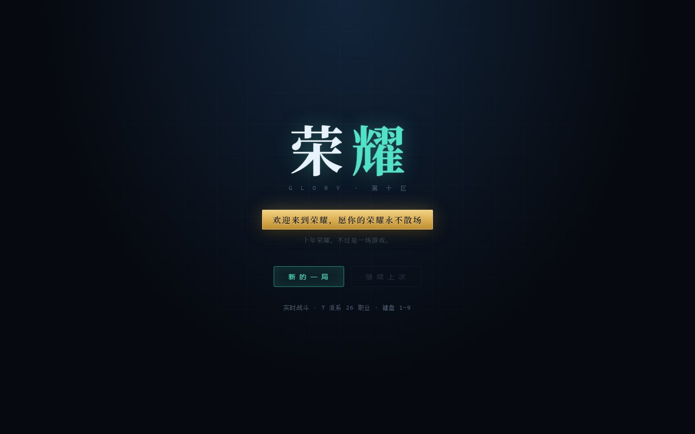
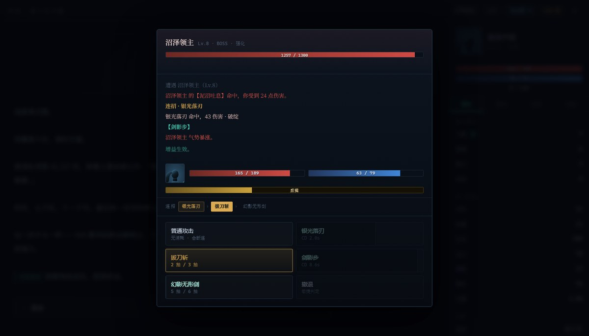
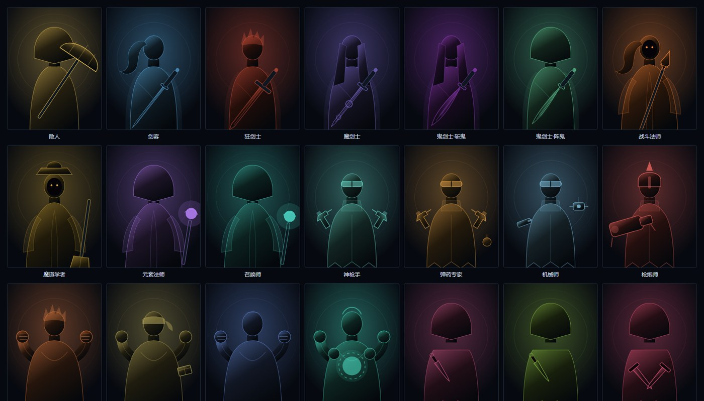
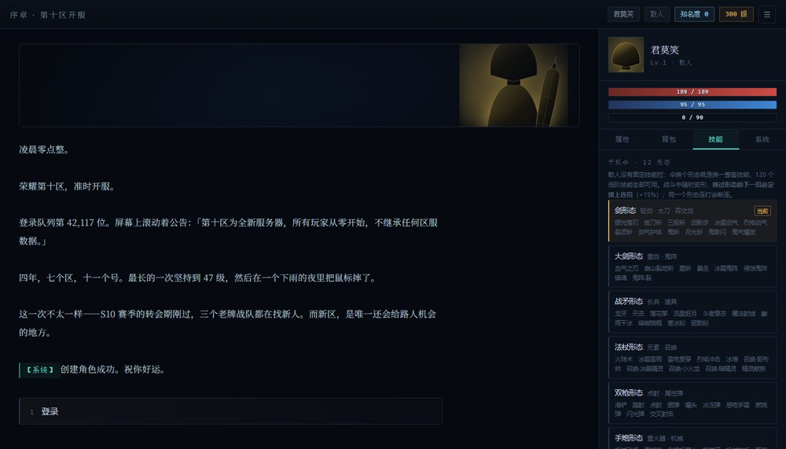
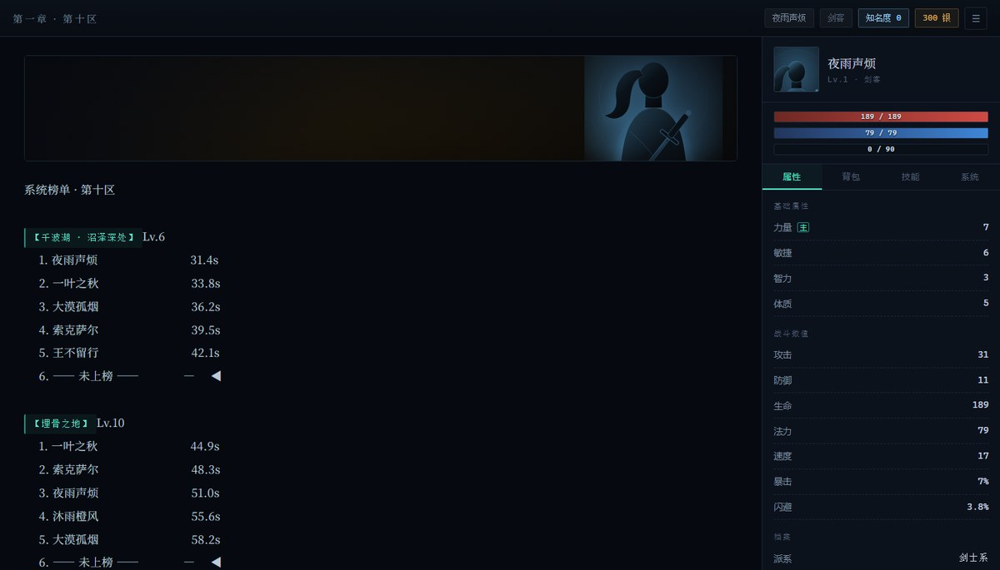
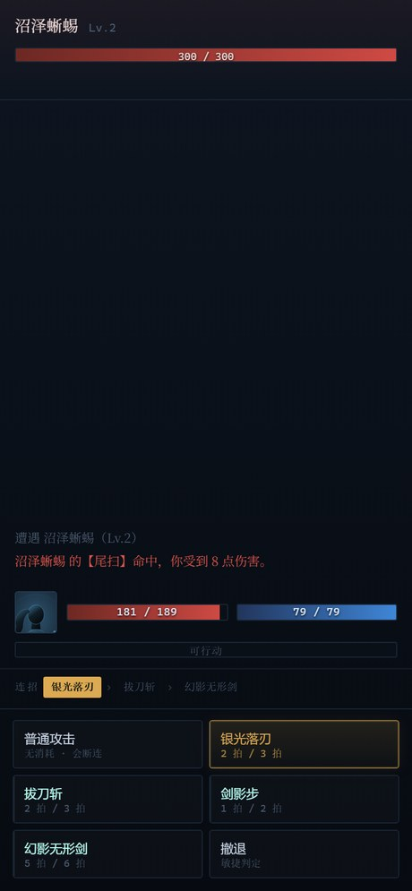

# 荣耀 · 第十区

> 一个跑在浏览器里的《全职高手》同人文字冒险游戏。
> 实时战斗、26 个职业、千机伞 12 形态、副本首杀与系统榜单。



---

## 这是什么

你是一个在第十区开服夜登录的路人玩家。没有背景、没有战队、没有资源，
只有一套连招和一双还算快的手。

从千波湖的沼泽一路打到挑战赛，把名字挂上系统榜单——
这是「路人王打职业」的那条线。

纯前端，零依赖，零后端。双击就能玩，也能直接发到手机上。

---

## 特性

| 模块 | 内容 |
|---|---|
| **职业** | 7 大派系 26 个职业，每个 4–5 个技能，各自有固定连招链 |
| **散人** | 千机伞 12 形态，120 个跨职业低阶技能全部可用，换形态即换技能组 |
| **战斗** | 实时前摇/后摇制，可打断、可破绽、可预输入，200ms 一拍 |
| **副本** | 4 个副本，首杀 / 刷新记录 / 系统榜单 / 知名度驱动主线解锁 |
| **立绘** | 参数化 SVG 生成，7 种体型 × 11 种头部 × 18 种武器，无外部图片 |
| **存档** | 浏览器本地存档，自动保存 |

### 实时战斗

不是回合制。双方各跑一条时间轴：

```
前摇 cast ──► 判定命中 ──► 后摇 rec ──► 可以动
   ↑被打中＝打断            ↑被打中＝破绽，伤害 +45%
```

- **接上连招**：后摇只剩 55%，伤害逐层 +18%，打满整套再 +30%、返一半法力、敌人破防
- **没接上就放**：后摇 160%，全程挂「破绽」
- **预输入**：后摇期间点下一招，收招瞬间自动接上
- **打断**：敌人头顶有施法条，在前摇结束前打中他，技能直接没了



### 26 个职业



### 散人 · 千机伞

十二种形态各对应一组职业的技能。变形免费，但**只有换过形态，下一招才能接上连招**——
所以散人的打法就是：每一刀都换一把伞。



### 副本与榜单

首杀和刷新记录都会上系统榜单，也会涨知名度；知名度过关，才有人来找你打职业。



---

## 怎么玩

### 手机

把 `dist/荣耀·第十区.html` 发到手机上，用浏览器打开。
单文件，166 KB，样式脚本全部内联，断网也能玩。



### 电脑

双击 `index.html`。

### 局域网（手机 + 电脑同一个 WiFi）

```bash
node server.js
```

窗口里会打印本机地址和局域网地址，手机浏览器输后者即可。
需要 Node.js，端口被占用会自动往上找。

---

## 项目结构

```
index.html              入口
dist/荣耀·第十区.html     单文件版（手机用，由 build.js 生成）
build.js                打包脚本：node build.js
server.js               局域网服务器（零依赖）
manifest.webmanifest    PWA 清单
icons/                  应用图标

classes.js              26 个职业与技能表
sanren.js               散人 120 技能 + 千机伞 12 形态
combat.js               实时战斗内核
engine.js               场景机 / 面板 / 存档 / 榜单
portraits.js            SVG 立绘生成器
data.js                 物品 / 敌人 / 副本 / 剧情
style.css               样式（含手机端适配）
使用说明.txt             写给玩家的版本
```

---

## 二次开发

改剧情只动 `data.js` 的 `SCENES`；改职业动 `classes.js`；改散人动 `sanren.js`。
改完重新打包手机版：

```bash
node build.js
```

没有构建工具、没有依赖、没有 npm install。

---

## 免责声明

本项目是《全职高手》（作者：蝴蝶蓝）的**非官方同人作品**，仅供学习和娱乐，
不用于任何商业用途，与原作作者及任何权利方无关。

- 世界观设定、职业名称、技能名称、角色名称的版权归原作者所有
- 代码与美术（均为程序化生成的 SVG）由本项目贡献者编写
- 仓库内**不含任何来自小说、动画、游戏的图片、音频或文本素材**
- 若权利方认为本项目不当，请联系删除

---

## 许可

代码以 [MIT](LICENSE) 协议开源。
